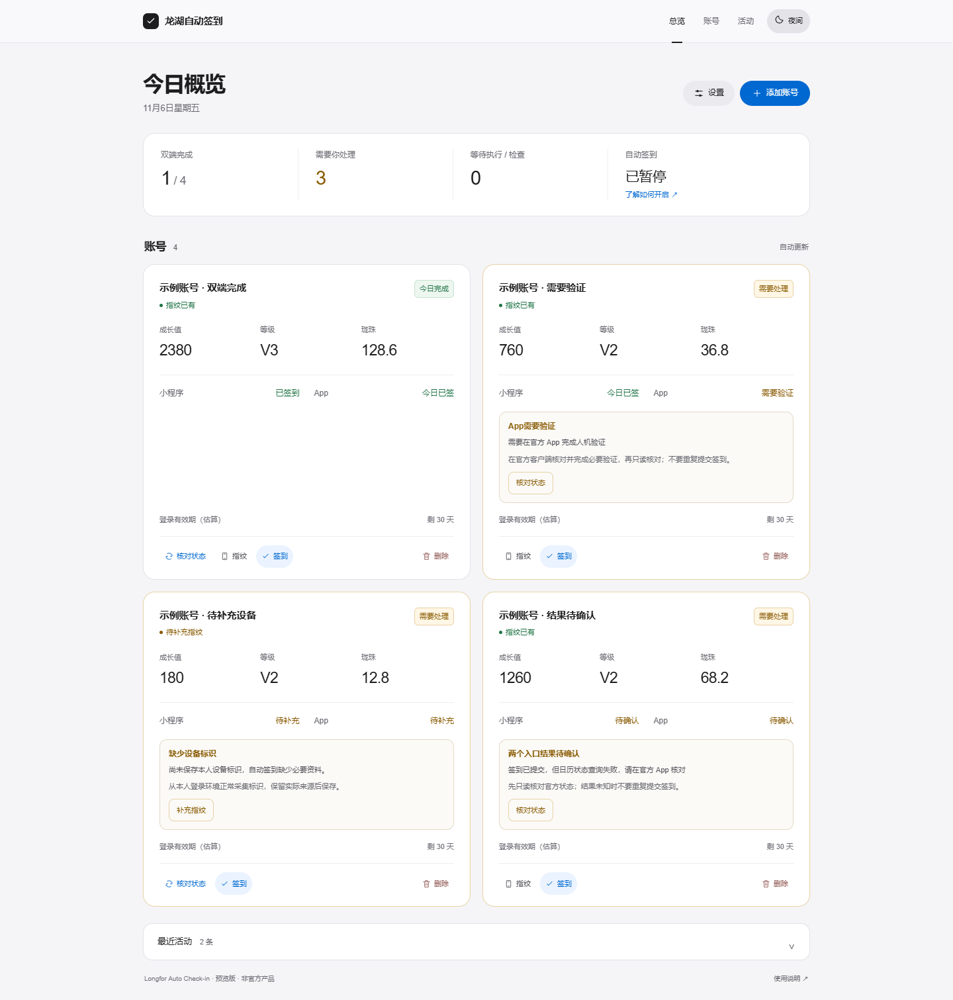

# Longfor Auto Check-in

**龙湖自动签到**：一个可以自己部署的个人签到看板，分别处理龙湖小程序和 App 活动，查看结果，并把每轮结果合并推送到手机。

项目按 [MIT 许可证](LICENSE) 开源，第三方许可声明见 LICENSE。项目不隶属于龙湖，也不代表官方服务。

> **当前为 0.2.0 预览版。** 双入口状态查询、鉴权、通知及离线回归测试已验证；自然跨日自动领取奖励、浏览器设备标识是否能领取 App 专享奖励，以及真实验证码自动处理仍待验证。请按自己的实际结果判断可用性，不把页面可访问或测试通过当作已到账。

## 能做什么

- **双入口分别确认**：小程序和 App 各自查询日历、执行并保存结果，页面区分“双端完成”“部分完成”和“待处理”。
- **控制重复提交**：同一账号的手动与定时执行互斥；先查已签状态；提交结果未知或风控拒绝时，当天只复核状态。
- **有界故障恢复**：提交前的查询故障、两端临时失败可退避重试；停机错过正常窗口后可补跑当天。
- **一条手机汇总**：支持 PushPlus、Bark、企业微信及钉钉。每轮合并两个入口与异常提示，通知失败不触发重新签到。
- **清楚的状态提示**：已完成、等待和需要处理分别显示；正常指纹简短显示“指纹已有”，异常集中说明原因及下一步。右上角可切换日间／夜间模式，浏览器记住选择，首次跟随系统。
- **自部署面板**：管理员密码鉴权、跨站来源检查、SQLite 持久化、Docker Compose；标准服务无需 Node.js 或前端构建。



截图使用虚构账号和演示数据，仅展示界面，不代表真实奖励或运行结果。

## 快速开始

推荐在 **Linux 主机，或 WSL 的 Linux 文件系统**内部署，需要 Docker、Docker Compose，以及用于首次初始化的 **Python 3.11 或更高版本**。初始化工具只使用 Python 标准库；Linux 上若没有 `python` 命令，可将下文命令替换为 `python3`。

1. 克隆本仓库，进入项目目录：

   ```bash
   git clone https://github.com/knightHuo/longfor-auto-checkin.git
   cd longfor-auto-checkin
   ```
2. 初始化管理员和本机配置：

   ```bash
   python tools/manage.py init
   ```

   默认用户名为 `admin`，可用 `python tools/manage.py init --username 你的用户名` 自定义。按提示设置至少 12 位的密码；密码通过隐藏输入读取，不放在命令行参数中。也可以运行 `python tools/manage.py init --generate-password` 生成随机密码；请保存终端首次显示的密码。

3. 启动：

   ```bash
   docker compose up -d --build
   ```

4. 打开 **http://127.0.0.1:8088**，用刚设置的管理员账号登录。

初始化会建立 `data/`、`secrets/panel-auth.json` 和 `.env`，不会覆盖已有配置。Linux 上以普通用户运行时，工具会为 Compose 配置当前用户的 UID/GID；以 root 运行时使用容器默认 UID/GID `10001`。这些私有目录和文件均不应提交到 Git。

初始化工具本身也可在 Windows 运行；容器部署请在 **WSL 的 Linux 目录**中克隆、初始化并运行 Compose。原生 Windows 共享卷的权限语义无法保证本项目所需的仅所有者可读权限，服务会拒绝不合要求的鉴权文件；不要为此放宽鉴权。参见 Docker 的[共享卷权限说明](https://docs.docker.com/desktop/troubleshoot-and-support/troubleshoot/topics/)和 [WSL 文件系统建议](https://docs.docker.com/desktop/features/wsl/best-practices/)。

默认端口只绑定本机，**自动调度和验证码自动处理均关闭**。远程服务器可先通过 SSH 隧道访问本机端口；需要浏览器直接远程访问时，应自行配置 HTTPS 反向代理和正确的公开来源，参见[部署与运行](#部署与运行)。

## 接入自己的账号

面板“添加账号”支持导入本人已登录环境中的 cURL、HAR 或会员 Token，可选择“添加新账号”或“更新登录：某账号”；更新登录会先验证新凭据，沿用原账号 ID 和历史，并保留本次未提供的设备与资料字段。同一 Token 不能重复绑定，账号执行中需等待任务结束后再更新。

- cURL / HAR 应来自龙湖业务请求。HAR 上传上限为 **5 MiB**，请只导出需要的会员业务请求。HAR 可能包含多个网站的凭据，导入前应缩小到需要的记录，使用后妥善处置。
- 签到还需要本人环境正常采集的设备标识及对应 User-Agent。只有 Token 时，可以验证登录和查询资料，不能据此假定具备签到所需设备凭据。
- 界面会保留设备标识的实际来源：**Android App = 1、iOS App = 2、普通浏览器 = 3、微信小程序 = 5**。不要为了尝试领奖修改来源或把浏览器标识写成 App 标识。
- 官方 U享家短信登录响应中的 `data.lzbToken` 是本项目使用的会员会话；`data.token` 属于另一种会话，不能互换。

`tools/official_login.py` 是可选的 Windows 本机登录辅助工具：需要安装本机 Chrome、Node.js 及 `npm ci` 依赖，由用户在官方页面完成短信登录，将会员会话写入 Windows 凭据管理器。它**不会自动把账号和设备标识导入面板**，也不保证所有网络环境都能完成短信登录。一般用户可先使用面板已有的导入方式。

首次使用先点 **“核对状态”**，查看资料与两个入口的当日状态，再决定是否运行。这个按钮对应 `GET /api/accounts/{id}/status`，只读查询，不续期、不提交签到，也不改写执行记录。**“签到”** 按钮会执行续期、签到和资料刷新。

### 登录与设备验证

服务会尝试续期，但不能承诺会话永不过期。面板的剩余天数按本地记录估算，服务端可以提前使登录失效；需要重新登录时，重新取得自己的有效凭据，在“添加账号”弹窗选择“更新登录：对应账号”后导入即可保留原账号记录。

设备标识帮助服务端判断请求环境，它不是验证码通行证。出现验证要求时，按官方页面提示完成必要验证；在 App 完成验证也不代表另一种浏览器环境一定获得信任。项目不会通过改来源、批量尝试或重复提交来解决风控拒绝。

## 开启自动签到

确认账号、设备来源及两端结果正确后，在 `.env` 中设置：

```dotenv
LONGFOR_SCHEDULE_ENABLED=1
```

再应用配置：

```bash
docker compose up -d
```

默认每天北京时间 **08:00–09:00** 之间选择一次执行时间，可在面板调整窗口。随机浮动设为 `0` 时使用固定时间。重启会重新计算下一次时间；若当天还未执行且已经错过窗口，会安排当天补跑，并先查询是否已签。

App 入口可选自动、只查状态并提醒手动处理、关闭。两个入口的状态及实际奖励需要分别核对，不能将其中一个入口成功当作双端完成。

## 手机通知

进入“设置”，选择通知方式并保存，再点“测试已保存的通知设置”。测试只发送通知，不执行签到。

**PushPlus**：填写[发送消息页面](https://www.pushplus.plus/)的用户 Token 或消息 Token，优先为本应用使用独立的消息 Token。普通发送接口不使用 Secret Key。保存后页面不会回显 Token，输入框留空表示保留，勾选清除才会删除。

**Bark / 企业微信 / 钉钉**：选择 Webhook，填写对应地址。Bark 支持官方地址 `https://api.day.app/<DeviceKey>` 及自建服务；企业微信和钉钉填写机器人完整 Webhook。

Webhook 保存后同样不回显原地址，只显示是否已配置；输入框留空保留已保存地址，显式勾选清除才会删除。

每轮汇总大致如下：

```text
【龙湖签到】2026-01-01

· 我的账号
小程序✅已签
App⚠️需要人机验证
  下一步：请在官方 App 完成验证后确认签到
```

全部已签也会汇总。一次失败重试是新的一轮，可能产生后续汇总。推送接口“已受理”只说明服务接受了请求，实际收件仍应在手机确认；不会为了通知失败重新提交签到。

## 部署与运行

### 配置

| 配置项 | 用途 |
| --- | --- |
| `LONGFOR_SCHEDULE_ENABLED` | 是否启动内置调度；首次安装为 `0` |
| `LONGFOR_PUBLIC_ORIGIN` | 浏览器实际访问的来源，例如 `https://checkin.example.com`；不含路径 |
| `LONGFOR_AUTH_FILE` | 管理员哈希文件路径；Compose 已配置容器内路径 |
| `LONGFOR_ROOT_PATH` | 反向代理子路径，例如 `/console`；直接访问留空 |
| `DATA_DIR` | SQLite 数据目录；容器默认 `/data` |
| `LONGHU_CAPTCHA` | 验证码处理模式；标准部署保持 `off` |

已有安装中的 `AUX_AUTH_FILE`、`AUX_PUBLIC_ORIGIN` 和 `AUX_SCHEDULE_ENABLED` 作为兼容别名保留；同时设置时，`LONGFOR_*` 配置优先。修改服务环境变量后，使用 `docker compose up -d` 重建容器使其生效。

公网访问使用自己的域名和 HTTPS；将 `LONGFOR_PUBLIC_ORIGIN` 设置为实际的 `scheme://host[:port]`。不要将本机 HTTP 示例直接当作公网部署方案。需要放到子路径时，反向代理与 `LONGFOR_ROOT_PATH` 必须一致，可参考 [`deploy/nginx.conf.example`](deploy/nginx.conf.example)。

### 运行约束

当前使用 **单个 Uvicorn 进程、单个服务实例**。账号锁和定时器在进程内工作，不能通过增加 `--workers` 或扩容副本获得可靠的防重复执行能力。多账号也应只由一个调度实例负责。

服务与通知请求使用直连，不继承系统代理。标准镜像默认非 root、文件系统只读，数据通过目录挂载保存。关闭或重建容器不会清空已挂载的数据库。

### 备份与升级

```bash
python tools/manage.py backup
git pull --ff-only
docker compose up -d --build
```

备份工具使用 SQLite 一致性快照，默认写入 `backups/`。数据库包含账号及通知凭据，应当按密钥材料保护。恢复前先停止服务，将选择的备份恢复到 `data/longhu.db`，确认目录权限和原配置后再启动。

升级会保留数据目录并补充新增字段。请保留升级前的数据库备份与镜像版本；涉及数据结构变化时，不要假定任意旧版本都能直接使用新数据库。

## 开发与架构

这是一个小型单体应用，按接口、业务编排、调度、存储和通知划分职责，避免为单机每日任务引入不必要的队列或微服务。模块和状态语义见[架构说明](docs/architecture.md)。

```bash
python -m venv .venv
# 激活虚拟环境后
python -m pip install -r requirements-dev.txt
python -m unittest discover -s tests
node --test tests/test_official_login.cjs
```

官方登录辅助工具的离线检查需要 Node.js。提交前应运行仓库 CI 定义的检查。所有自动测试应使用虚构数据和模拟响应，不在公共 CI 中登录真实账号、提交签到或发送真实通知。

验证码自动处理是独立的**实验能力**，涉及可选浏览器和图像识别依赖，默认关闭，不属于标准镜像的可用性承诺。真实挑战尚未完成验收，不建议把它作为无人值守部署的前提。

## 贡献与反馈

欢迎报告接口变化、可复现的问题及改进建议，参见[贡献指南](CONTRIBUTING.md)。反馈时提供版本、脱敏日志与预期行为，不上传登录态、设备标识、HAR 原件或数据库。

安全问题和凭据泄露按[安全说明](SECURITY.md)处理，不在公开 Issue 张贴密钥。

## 许可

代码按 [MIT](LICENSE) 发布，第三方许可声明见 LICENSE。项目名称用于说明适配对象，不表示官方授权或服务合作。登录凭据、设备数据及第三方服务的使用仍由各自服务规则约束。
