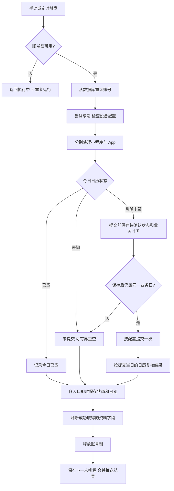

# 架构与状态语义

Longfor Auto Check-in 使用一个 Python Web 服务、一个 SQLite 数据库和内置定时器。标准部署只有一个应用进程；浏览器页面无需构建或 Node.js 运行环境。

## 模块

| 模块 | 职责 |
| --- | --- |
| `app/main.py` | 管理 API、页面、生命周期及请求参数校验 |
| `app/security.py` | 管理员密码鉴权、来源检查和响应安全头 |
| `app/parser.py` | 从 cURL、HAR 或直接输入提取会员凭据与设备信息 |
| `app/longhu.py` | 上游接口调用、日历判断、续期、签到和资料查询 |
| `app/runner.py` | 单账号完整流程、独立入口落库和一轮通知汇总 |
| `app/run_guard.py` | 同账号的进程内非阻塞执行锁 |
| `app/scheduler.py` | 首跑窗口、补跑、有界重试及下一次排程 |
| `app/db.py` | SQLite 访问、默认配置、字段迁移和业务日期 |
| `app/notifications.py` | PushPlus / Webhook 协议适配与安全返回值 |
| `app/captcha.py` | 可选实验求解器的进程边界；默认关闭 |
| `app/static/index.html`、`app/static/styles.css`、`app/static/ui-state.js` | 同源页面、日夜主题和状态展示；无需前端构建 |
| `tools/manage.py` | 本地初始化及一致性备份，不参与签到执行 |

`tools/official_login.*` 等辅助工具在使用者本机运行，与服务端签到进程分开。它们不应成为标准服务必须安装的依赖。

管理页面将“核对状态”和“签到”分开：前者只读查询两路日历与资料，不续期、不提交或改写执行记录，仅在当前页面会话内叠显带时间的官方核对结果并保留原执行背景；后者进入完整账号流程。HAR 上传在解析前限制为 5 MiB。

只读接口 `GET /api/accounts/{account_id}/status` 在每路日历请求发起前采集北京时间，并返回该入口的开始时间 `entry_checked_at` 和业务日 `entry_dates`，供页面与同期落库的执行记录比较。`today` 与 `checked_at` 来自整次核对完成时的北京时间。所有时间戳使用带毫秒及 `+08:00` 偏移的 ISO 格式。跨午夜时，`errors` 指出哪些入口在前一个业务日开始查询。任一路日历或资料查询明确返回鉴权失败时，`auth_expired` 为 `true`。

账号导入支持通过 `account_id` 更新既有账号的登录态：验证新凭据后保留账号 ID、历史及未提供的设备/资料字段；同 Token 重复绑定在数据库事务内拒绝，执行中的账号更新返回 HTTP 409。

## 执行流程

当天记录为 `risk` 或 `todo` 的入口只读复核日历，确认已签时更新为 `already`。小程序最终为 `risk` 或 `todo` 时，同日 App 自动入口只读核对，包括进程中断后仅保存了小程序提交意图的情况。App 已签记 `already`，未签或未知时保留已有暂停状态，或沿用小程序的暂停状态。小程序复核为 `already` 后解除小程序对 App 的限制。关闭 App 时本轮返回 `skipped`，数据库保留同日原有的 `risk` 或 `todo`，重新开启后继续按暂停状态处理。

每个入口开始时独立确定北京时间业务日。上一业务日的小程序暂停状态不限制次日 App。提交意图写入前后都核对业务日，首次提交前发现跨日时记录原入口业务日的 `retry`，下次执行先重新查询当日日历。

真正发出签到请求前，先将该入口的 `todo` 与提交时间持久化。提交结果沿用意图时间落库。响应跨午夜时，次日日历不能确认上一日提交成功。若进程在提交附近中断，重启后会先只读复核。恢复保护适用于单进程单实例。

账号 API 的 `is_busy` 是当前进程中账号互斥锁的只读快照。页面在处理期间显示蓝色“处理中”，避免将提交中的临时 `todo` 误报为人工问题；释放锁后按真实结果提示。它不写入数据库，也不改变签到状态。今日尚未执行的入口不使用昨日错误生成新告警；已有指纹只表示本地配置存在，不代表通过服务端验证。

## 状态合同

| 状态 | 含义 | 调度处理 |
| --- | --- | --- |
| `ok` | 本轮提交后已按日历确认成功 | 无需重试 |
| `already` | 当天已签或只读复核确认已签 | 无需重试 |
| `retry` | 提交前无法取得明确状态，尚未提交 | 有界退避后重新查询 |
| `fail` | 明确失败或流程异常 | 有界重试；每次仍先查日历 |
| `busy` | 同账号已有流程在执行 | 不并发提交，可稍后重试 |
| `todo` | 提交结果未知、需要重新认证或缺少必要配置等需处理状态 | 不盲目重发 |
| `risk` | 需要人机验证或被风控拒绝 | 当天只读复核，等待处理 |
| `conflict` | 多账号共用设备标识导致暂停 | 修正设备配置后再核对 |
| `skipped` | 入口关闭或本轮没有执行 | 不据此宣称签到成功 |

两个入口分别保存状态。总览只有在所有启用入口均为 `ok/already` 时才计为完成；单端完成显示“部分完成”。日期使用北京时间，资料刷新不会将昨日签到状态改记为今天。

续期、签到查询、签到提交或结果复核发现明确的 HTTP 401、未登录或会话失效时，账号需要重新认证，剩余签到入口及资料刷新停止使用该登录态。签到接口返回成功后仍以日历复核为准。提交响应缺少业务码、无法解析或业务码不符合诊断格式时，日历未确认已签则记为 `todo`，当天暂停自动重发。

## 调度与通知

首跑在配置窗口内随机选择时刻。服务重启后，若当天尚未完成但已错过窗口，可安排当天补跑。失败按 10、20、30、40 分钟退避，达到上限后当天不继续自动重试。临近午夜不会把旧业务日的重试计数或完成结果移到新一天。

调度日志按排程结果报告可重试账号数、已安排重试账号数和需人工处理账号数。重试耗尽或跨午夜结算的失败账号计入人工处理。

一次性任务开始后会从 APScheduler 的待执行列表消失。因此，运行状态与排程操作共用锁；巡场在任务运行中不创建下一轮，当前任务保存结果后再重新计算。

定时流程先保存业务结果和下一轮排程，再发送通知。推送失败不改变签到结果或创建新的签到重试。PushPlus 的同步成功响应表示请求已受理，不能替代实际收件确认。

## 数据与安全边界

- SQLite 保存账号、入口结果、日志与设置，包含敏感会员及通知凭据。管理员鉴权文件只保存加盐密码哈希；这不等于数据库已经加密。
- Web API 隐去原始会员 Token、设备标识、User-Agent、PushPlus Token 及 Webhook 地址。通知设置只返回是否已配置；留空保留，显式清除才删除。脱敏覆盖 `Authorization` 中的认证方案及凭据。日历与签到诊断日志使用固定事件、入口、耗时及适用的日历结果，诊断码允许 3 至 7 位 ASCII 数字及内部标记 `parse_error`。续期和资料查询的业务错误仅使用固定提示和白名单内的业务码。已知凭据及不符合对应规则的业务码记为 `invalid`。
- 新增字段通过幂等迁移补齐。升级和迁移前应使用 SQLite 一致性备份，不能在数据库写入时简单复制主文件而忽略日志文件。
- 上游请求和通知请求不使用系统代理。标准服务不需要外部中转或第三方验证码服务。
- 当前执行锁、调度运行状态都是进程内状态。扩容副本或增加 Web workers 前，必须重新设计任务归属、分布式互斥及重复提交恢复，不能只调整容器数量。

## 验证层级

单元与集成测试覆盖模拟上游响应、临时 SQLite、鉴权、并发和排程。构建成功、健康检查与页面检查只证明相应层级；真实自然跨日执行、双入口领取和奖励到账仍需独立确认。可选验证码工具的离线测试不能证明真实挑战可以通过。
